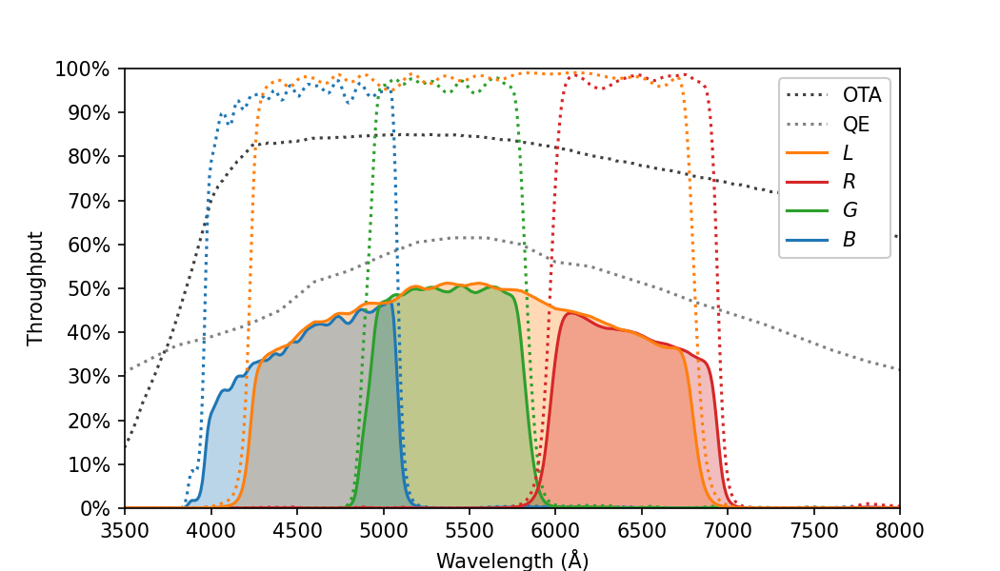

# throughput
This directory contains model throughput data for the GOTO telescopes. See `throughput.ipynb` for some examples and plots.

Data files are stored in `/data`, either as individual elements or a combined CSV file (created by `throughput.ipynb`).

## GOTO filter properties

GOTO uses a Baader LRGBC set of filters (https://www.baader-planetarium.com/en/filters/filter-sets/baader-l-rgb-c-ccd-filterset.html). C is clear glass, and is not used for observing.

The values in this table (and the plot above) are output by  `throughput.ipynb`.

| Filter | Midpoint | Bandwidth | Throughput (no atm) |
| - | - | - | - |
| L | 5469 Å | 2536 Å | 0.4505 e-/ph |
| R | 6449 Å |  963 Å | 0.4035 e-/ph |
| G | 5371 Å |  911 Å | 0.5064 e-/ph |
| B | 4532 Å | 1066 Å | 0.4005 e-/ph |

The values in this table are output by `synphot.ipynb`. Sky fluxes are in e-/s/cm²/arcsec². The 5-sigma limiting magnitude is for a single 60s exposure in a dark sky, at airmass 1 and with seeing of 1.5.

| Filter | Zeropoint   (AB mag) | Zeropoint   (Vega mag) | Dark sky flux  | Grey sky flux | Bright sky flux | Extinction   (mag/airmass) | Limiting mag |
| - | - | - | - | - | - | - | - |
| L | 22.63 | 22.63 | 0.0031 | 0.0172 | 0.0329 | 0.150 | 19.75 |
| R | 21.28 | 21.08 | 0.0013 | 0.0049 | 0.0091 | 0.099 | 18.50 |
| G | 21.66 | 21.67 | 0.0012 | 0.0070 | 0.0138 | 0.145 | 18.84 |
| B | 21.75 | 21.87 | 0.0007 | 0.0075 | 0.0140 | 0.220 | 18.86 |
